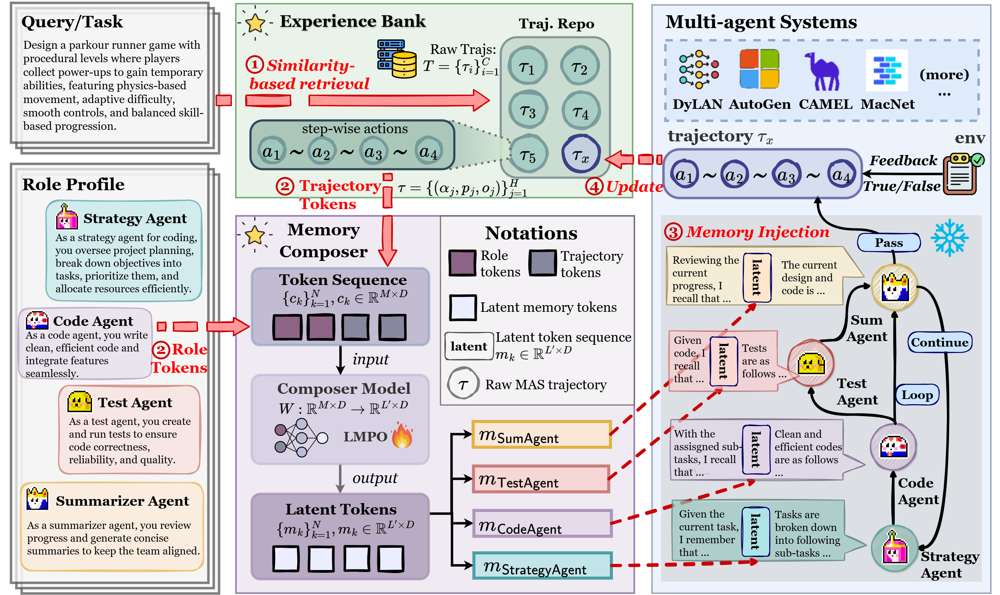

# LatentMem: Customizing Latent Memory for Multi-Agent Systems

> 🎉 LatentMem has been accepted to **EMNLP 2026 Main Conference**!

## 👋 Introduction
This repo is the official implementation of ***LatentMem: Customizing Latent Memory for Multi-Agent Systems***.

LatentMem is a learnable multi-agent memory framework that generates role-aware, token-efficient latent memories for LLM-powered multi-agent systems (MAS). It combines a lightweight experience bank to store raw interaction trajectories with a memory composer that distills compact, role-aware latent memories conditioned on agent profiles. Using Latent Memory Policy Optimization (LMPO), LatentMem encourages the memory composer to produce high-utility, transferable representations.



## 🌎 Setup
**Step 1: Code environment**
```
conda env create -f environment.yml
conda activate latentmem
```

**Step 2: Search environment**  
Please follow the instructions in the [Search-R1](https://github.com/PeterGriffinJin/Search-R1?tab=readme-ov-file#retriever-environment-optional) to configure the retriever environment (optional).

## 🤗 Quick Evaluation
### Step 1: Trajectoy and Model
We have released both the training trajectories (across all in-domain datasets) and the trained LatentMem model (via LMPO), based on Qwen3-4B-Instruct-2507, on Hugging Face:

- Trajectories: 👉 [Kana-s/LatentMem-Qwen3-4B-Trajectory](https://huggingface.co/datasets/Kana-s/LatentMem-Qwen3-4B-Trajectory)  
- Model: 👉 [Kana-s/LatentMem-Qwen3-4B](https://huggingface.co/Kana-s/LatentMem-Qwen3-4B)

### Step 2: Setup Instructions
To ensure the evaluation scripts function correctly, please download the above repositories and placed them into the `results/` directory as follows:
```
results/
├── LatentMem-Qwen3-4B-Trajectory/
│   ├── generative/
│   ├── gmemory/
│   ├── latentmem/
│   ├── metagpt/
│   ├── oagent/
│   └── voyager/
└── LatentMem-Qwen3-4B/
    ├── data/
    └── model/
```

### Step 3: Evaluation
Once the files are in place, you can verify the model performance by running the provided evaluation script:
```bash
bash scripts/eval_hf.sh
```

## ▶️ Training
LatentMem collects trajectories into an experience bank and optimizes the memory composer via LMPO, preceded by an SFT cold start.

### Step 1: Data Collection
Collect raw trajectories into the experience bank:
```bash
bash scripts/data.sh
```

### Step 2: SFT Cold Start
Initialize the memory composer with supervised fine-tuning on collected trajectories before LMPO:
```bash
bash scripts/sft.sh
```

### Step 3: LMPO Train
Train the memory composer using LMPO:
```bash
bash scripts/lmpo.sh
```

### Step 4: Evaluate
Evaluate LatentMem:
```bash
bash scripts/eval.sh
```

## 🫡 Citation
If you find this repository helpful, a citation to our paper would be greatly appreciated:
```
@misc{fu2026latentmemcustomizinglatentmemory,
      title={LatentMem: Customizing Latent Memory for Multi-Agent Systems}, 
      author={Muxin Fu and Xiangyuan Xue and Yafu Li and Zefeng He and Siyuan Huang and Xiaoye Qu and Yu Cheng and Yang Yang},
      year={2026},
      eprint={2602.03036},
      archivePrefix={arXiv},
      primaryClass={cs.CL},
      url={https://arxiv.org/abs/2602.03036}, 
}
```

## 🙏 Acknowledgement
We sincerely thank [Search-R1](https://github.com/PeterGriffinJin/Search-R1?tab=readme-ov-file#retriever-environment-optional) for open-sourcing their search web environment.
